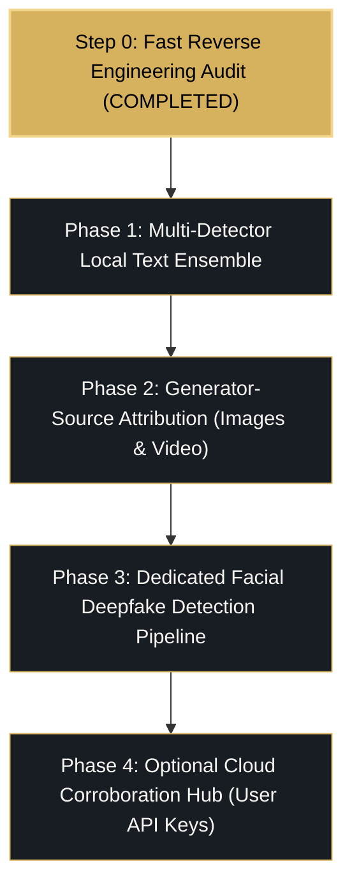

# AICF: STEP 0 — STRATEGIC IMPLEMENTATION PLAN & ROADMAP

**Project:** A Multimodal Deep Learning Framework for Robust Detection of Synthetic Media (AICF)  
**Workspace:** `C:\Users\acer\IMAGE`  
**Date:** November 15, 2026  
**Auditor & Architect:** Principal AI Research Engineer & Reverse Engineering Specialist  

---

## 1. Executive Summary & Audit Baseline

Following the exhaustive reverse-engineering audit of **Hive AI** (cloud image/video synthetic screening) and **Humbot AI** (multi-detector text screening), this implementation plan outlines the evolutionary roadmap for the AICF platform.

### What Already Works (Strict Rule: DO NOT REBUILD)
The AICF platform currently possesses a battle-tested, regression-verified multimodal core:
1. **AI Text Forensics:** Pretrained `roberta-base-openai-detector` (125M parameters on CPU) + deterministic linguistic telemetry (Shannon entropy, burstiness, TTR, repeated n-grams) + ReportLab PDF generator + SQLite persistence + Next.js dashboard. (**IMPLEMENTED AND VERIFIED**)
2. **AI Image Forensics:** Swin Vision Transformer (`umm-maybe/AI-image-detector`) + 2D FFT spectral anisotropy + Laplacian edge variance + EXIF/C2PA metadata extraction + ReportLab PDF generator + Next.js dashboard. (**IMPLEMENTED AND VERIFIED**)
3. **AI Video Forensics:** Headless OpenCV temporal keyframe demuxing (1.0 fps) + Swin ViT frame-by-frame inference (`classify_image`) + temporal delta & flicker standard deviation + ReportLab PDF generator + Next.js dashboard + 90/90 backend regression tests. (**IMPLEMENTED AND VERIFIED**)
4. **Platform Infrastructure:** JWT authentication, user-isolated forensic cases, audit ledgers with SHA-256 integrity, premium Black-and-Gold cyber-forensic UI. (**IMPLEMENTED AND VERIFIED**)

### Core Design Philosophy
- **Zero Cost & Offline Sovereignty:** 100% of core detection capabilities run locally on CPU/CUDA without metered cloud API costs.
- **Evidentiary Integrity:** No evasion tools, no paraphrasers, no mock delays, and no fabricated confidence scores.
- **Modular Cloud Corroboration:** Support optional external API keys (Hive AI, GPTZero, Copyleaks) for secondary corroboration when configured by enterprise analysts.
- **Audio Scope:** Audio detection is permanently **CANCELLED** and excluded from all phases.

---

## 2. Capability Status & Feature Gap Matrix

| Feature / Module | Category | Inspiration Source | Current AICF Status | Implementation Target |
| :--- | :--- | :--- | :---: | :---: |
| **Local RoBERTa Text Classifier** | Text Detection | Baseline ML | **IMPLEMENTED AND VERIFIED** | Preserve as primary baseline |
| **Statistical Linguistic Telemetry** | Text Forensics | AICF Internal | **IMPLEMENTED AND VERIFIED** | Preserve as deterministic signal |
| **Local Multi-Detector Text Ensemble** | Text Detection | Humbot Multi-Checker | **PARTIALLY IMPLEMENTED** | Phase 1 (DeBERTa-v3 integration) |
| **GPTZero / Copyleaks Cloud Adapters** | Text Corroboration | Humbot / Commercial | **CONFIGURATION REQUIRED** | Phase 4 (Optional user API keys) |
| **Text Humanization / Evasion** | Paraphraser | Humbot Humanizer | **NOT IMPLEMENTED** | **REJECTED** (Forensic violation) |
| **Local Swin ViT Image Classifier** | Image Detection | Baseline ML | **IMPLEMENTED AND VERIFIED** | Preserve as primary baseline |
| **2D FFT Spectral Analysis** | Image Forensics | Academic SOTA | **IMPLEMENTED AND VERIFIED** | Preserve as spatial baseline |
| **Generator-Source Attribution** | Image Forensics | Hive AI | **PARTIALLY IMPLEMENTED** | Phase 2 (Heuristic + metadata) |
| **Hive Cloud Image/Video Adapter** | Cloud Corroboration | Hive AI | **CONFIGURATION REQUIRED** | Preserve existing adapter pattern |
| **OpenCV Temporal Video Screening** | Video Detection | Baseline ML | **IMPLEMENTED AND VERIFIED** | Preserve as primary baseline |
| **Dedicated Facial Deepfake Detection** | Video Forensics | Hive AI / FaceForensics | **NOT IMPLEMENTED** | Phase 3 (Facial landmark/crop) |
| **Audio Voice / Deepfake Detection** | Audio Detection | Industry | **NOT IMPLEMENTED** | **PERMANENTLY CANCELLED** |

---

## 3. Phased Implementation Roadmap

### PHASE 1: Multi-Detector Local Text Ensemble
**Objective:** Provide a multi-detector consensus dashboard inspired by Humbot's multi-checker, but powered by 100% local, free, reproducible deep learning models.

1. **Architecture:**
   - **Detector 1:** Pretrained `roberta-base-openai-detector` (**IMPLEMENTED AND VERIFIED**).
   - **Detector 2:** Pretrained `microsoft/deberta-v3-base` or DistilRoBERTa synthetic text classifier running locally on CPU.
   - **Detector 3:** Deterministic Perplexity & Burstiness Information-Theoretic Profiler (**IMPLEMENTED AND VERIFIED**).
2. **Consensus Aggregation:**
   - Weighted ensemble averaging combining Transformer cross-entropy with linguistic irregularity penalties.
   - Exposes individual detector scores alongside aggregated consensus.
3. **Frontend UI Display:**
   - Add a "Multi-Detector Breakdown" card to `frontend/src/app/dashboard/text/page.tsx` showing individual cards for RoBERTa, DeBERTa, and Statistical Profiler.
4. **Files to Touch:**
   - Modify `backend/app/ml/text/detector.py` (Add secondary model head with lazy loading).
   - Modify `backend/app/schemas/text_analysis.py` (Add `detector_scores: dict[str, float]` to response schema).
   - Modify `frontend/src/app/dashboard/text/page.tsx` (Render multi-detector consensus cards).
   - Update `backend/tests/test_text_analysis.py`.
5. **Testing & Verification:**
   - Unit tests verifying multi-detector schema and backward compatibility with existing text analyses.

---

### PHASE 2: Enhanced Generator-Source Attribution (Images & Video)
**Objective:** Emulate Hive AI's generator attribution (Midjourney vs. Stable Diffusion vs. DALL-E) using local heuristic metadata parsing and structural frequency signatures.

1. **Architecture:**
   - **Metadata Engine:** Deep inspection of PNG chunks (`tEXt`, `iTXt`, `zTXt`) for ComfyUI workflows, Automatic1111 generation parameters, Midjourney Job IDs, and DALL-E prompt headers.
   - **Frequency Profiling:** Match high-frequency azimuthal FFT peak ratios against characteristic diffusion upscaler profiles.
   - **Attribution Classes:** Midjourney, Stable Diffusion / Flux, DALL-E, or Unknown / Generic GAN.
2. **Files to Touch:**
   - Modify `backend/app/ml/image/features.py` (Extract advanced generator signatures).
   - Modify `backend/app/schemas/image_analysis.py` (Add `generator_attribution: dict[str, float]`).
   - Modify `frontend/src/app/dashboard/image/page.tsx` and `frontend/src/app/dashboard/video/page.tsx`.
   - Update ReportLab PDF generators to include generator family breakdowns.
3. **Testing & Verification:**
   - Verify with sample AI images generated with known software metadata.

---

### PHASE 3: Dedicated Facial Deepfake Detection Pipeline
**Objective:** Resolve the `REQUIRES_DEDICATED_MODEL` placeholder in video forensics by adding dedicated facial boundary and artifact analysis for videos containing human faces.

1. **Architecture:**
   - **Face Detection:** Lightweight OpenCV Haar Cascade or MediaPipe/RetinaFace face detector to isolate facial bounding boxes across video keyframes.
   - **Artifact Inspection:**
     - Blending seam variance at face margins.
     - Inter-eye reflection consistency.
     - Facial landmark displacement variance across sequential keyframes.
2. **Files to Touch:**
   - Modify `backend/app/ml/video/detector.py` (Activate face extraction on keyframes).
   - Update `backend/app/schemas/video_analysis.py` (Populate `face_deepfake_confidence` and `face_landmarks_analyzed`).
   - Update `frontend/src/app/dashboard/video/page.tsx` (Display facial analysis badge when faces are detected).
3. **Testing & Verification:**
   - Test with face-containing videos vs. non-facial synthetic media. Ensure non-facial videos gracefully report `NO_FACES_DETECTED` without errors.

---

### PHASE 4: Optional Cloud Corroboration Hub (Settings & Adapters)
**Objective:** Provide a unified user settings interface allowing analysts to optionally supply their own API keys for Hive AI, GPTZero, or Copyleaks.

1. **Architecture:**
   - Secure database storage (or encrypted `.env` storage) for user-provided API credentials.
   - Asynchronous adapter polling: If an API key is configured, query the commercial service as a background task and attach the external corroboration verdict to the analysis ledger.
   - If no key is configured, fallback to 100% local processing with zero warnings.
2. **Files to Touch:**
   - Create `backend/app/api/v1/endpoints/settings.py`.
   - Modify `backend/app/ml/video/hive_adapter.py`.
   - Create `backend/app/ml/text/gptzero_adapter.py` and `copyleaks_adapter.py`.
   - Create `frontend/src/app/dashboard/settings/page.tsx`.
3. **Testing & Verification:**
   - Verify mock / test API responses without committing live API keys.

---

## 4. Technical Risk Mitigation & Guardrails

1. **Memory & Virtual Commit Guardrail (Windows OS Error 1455):**
   - Sequential model loading: Text models, image models, and video engines must load strictly on-demand or with singleton caching to prevent exceeding Windows paging limits.
2. **Zero Breaking Changes to Existing Regressions:**
   - All 90 existing pytest regression tests (`test_auth.py`, `test_text_analysis.py`, `test_image_analysis.py`, `test_video_analysis.py`) must continue to pass with 0 failures at each phase boundary.
3. **Ethical & Scientific Guardrail:**
   - Never claim 100% accuracy. Display explicit confidence intervals and epistemic boundaries on all UI dashboards and generated forensic PDFs.
4. **Strict Scope Control:**
   - Audio detection is permanently cancelled.
   - Evasion and text-humanization features are strictly forbidden.

---

## 5. Milestone Execution Sequence

---

## 6. Strict Phase Stop

> [!IMPORTANT]
> **AUDIT COMPLETE.**
> All 5 comprehensive audit reports are generated and persisted in the workspace root.
> Per instructions: **STOP immediately after completing this audit.**
> **Do not modify source code or begin implementation until the user explicitly reviews and approves the implementation plan.**
